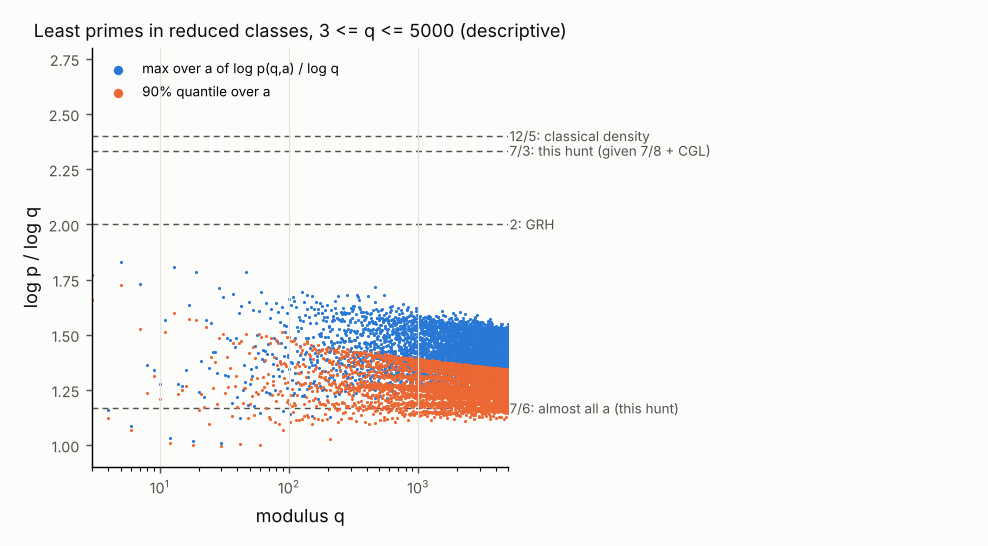

# Linnik's constant from the 7/8 zero-free half-plane: results

**Status: candidate, pending external review.** Grade of every theorem below:
proved (ordinary written proof, written by a model in this hunt, not yet reviewed
by anyone), *given OpenAI's Theorem 1.1* and the density input named in the
statement. A composite claim takes the grade of its weakest step, and the weakest
step here is OpenAI's 195-page argument, which no human has reviewed (its Lean
statements are kernel checked on two kernels, the argument behind them is not
replayed here). Nothing in this file is promoted by the hunt itself.

## 0. Results at a glance

`p(q,a)` is the least prime `p = a (mod q)`, `(a,q) = 1`. "Effective" means every
constant is computable in principle: no step uses Siegel's theorem or any other
ineffective input. No constant is computed.

| statement | exponent | inputs besides OpenAI Theorem 1.1 |
| --- | --- | --- |
| Theorem A: `p(q,a) <= C(eps) q^(7/3 + eps)` for all `q`, all `a` | **7/3 = 2.333...** | Chen-Gupta-Li, arXiv:2507.08296v2, Theorem 1.2 (preprint) |
| Theorem A': the same with exponent 12/5 | 12/5 = 2.4 | Montgomery's Ingham-type bound and Huxley 1975 (refereed) |
| Corollary B: `psi(x;q,a) = x/phi(q) (1 + O(x^-delta))`, `pi(x;q,a) = li(x)/phi(q) (1 + O(x^-delta))` | for `x >= q^(7/3 + eps)` | as Theorem A |
| Corollary C: all but `O(phi(q) x^-delta)` reduced classes contain a prime in `[x/2, x]` | for `x >= q^(7/6 + eps)` | as Theorem A |
| Corollary D: moduli whose prime factors are all `<= q^eta0` | 30/13 = 2.3077 | CGL Theorem 1.2, smooth case |
| Corollary E: moduli with a divisor in `[q^0.93, q^0.95]` | 2.31846... | CGL Theorem 1.2, divisor form |
| Corollary G: least Goldbach number `p1 + p2 = k (mod q)`, any modulus, admissible `k` | 7/6 | as Theorem A |
| Remark F: dependence on the half-plane `Re s > theta` | `3/(2 - theta)` for `theta <= 5/7`; 7/3 for `5/7 <= theta < 1` | as Theorem A |

**Against what.** Unconditionally `L = 5` (Xylouris, Bonn thesis 2011) and
`L < 5` (Xylouris, Chebyshevskii Sbornik 2018) are the refereed records; an
AI-assisted preprint claims 3.99 (Naslund, hexagonmath.org 2610.00018v1,
2026-10-02, unreviewed). The English Wikipedia table "Linnik's theorem", read
2026-10-08, lists `L = 2.4` as a "corollary of 7/8 Quasi-Riemann Hypothesis"
attributed to OpenAI; that is the Ingham-Huxley exponent 12/5 (Theorem A' here).
The OpenAI paper text available to this hunt states no Linnik bound
(`grep -i linnik` on both extracted texts is empty). Theorem A lowers 12/5 to 7/3.
Under GRH the exponent is `2 + eps`. The improvement from 12/5 to 7/3 comes from
the Chen-Gupta-Li density estimate, not from anything new about the half-plane.

**The half-plane's role is qualitative.** Any fixed zero-free half-plane
`Re s > theta` with `5/7 <= theta < 1` gives the same 7/3 from current density
estimates (Remark F). What the 7/8 theorem buys is that there is *some* such
`theta`: it removes the Siegel zero, the log-free density estimate and the
Deuring-Heilbronn repulsion from the argument entirely. OpenAI's October 5
paper's weaker 11/12 half-plane would give the same exponents.

## 1. Statements

Notation. `chi` runs over Dirichlet characters mod `q`; `chi*` is the primitive
character mod `q* | q` inducing `chi` (`chi* = 1`, `q* = 1` for the principal
character, and then `L(s, chi*) = zeta(s)`). `Z(chi*)` is the multiset of
nontrivial zeros `rho = beta + i gamma` of `L(s, chi*)` (for primitive `chi*`
these are its zeros with `0 < beta < 1`). For `sigma >= 0`, `T > 0`

    N_q(sigma, T) = sum over chi mod q of #{rho in Z(chi*) : beta >= sigma, |gamma| <= T}.

For `sigma > 0` this is CGL's `sum_{chi mod q} N(sigma, T, chi)`: the factor
`prod_{p | q} (1 - chi*(p) p^-s)` relating `L(s, chi)` to `L(s, chi*)` vanishes
only on `Re s = 0`. Two hypotheses:

* **Z(theta)**: no Dirichlet L-function vanishes in `Re s > theta` (pole at
  `s = 1` of the principal character excepted). OpenAI's Theorem 1.1 is Z(7/8).
* **D(A)**: `A : (1/2, 1) -> [0, infinity)`, and for every `sigma` in `(1/2, 1)` and
  `eps > 0` there is an effectively computable `C(sigma, eps)` with
  `N_q(sigma, T) <= C(sigma, eps) (qT)^(A(sigma)(1 - sigma) + eps)` for all
  `q >= 1`, `T >= 2`.

Put `A*(theta) = max(2, sup over 1/2 < sigma <= theta of A(sigma))`.

**Theorem P (the deduction).** Assume Z(theta) for some `1/2 <= theta < 1` and
D(A) with `A* = A*(theta) < infinity`. For every `eps0 > 0` there are effectively
computable `delta > 0` and `C` such that for all `q >= 1`, `(a, q) = 1`:

1. `|psi_w(x; q, a) - W(1) x / phi(q)| <= C x^(1 - delta) / phi(q)` for
   `x >= q^(A* + eps0)` (smoothed count, weight `w` of section 3);
2. there is a prime `p = a (mod q)` with `x/2 <= p <= x` for every
   `x >= C q^(A* + eps0)`; in particular `p(q, a) <= C q^(A* + eps0)`.

**Theorem A.** Given OpenAI's Theorem 1.1 and CGL Theorem 1.2: for every
`eps > 0` there is an effectively computable `C(eps)` with
`p(q, a) <= C(eps) q^(7/3 + eps)` for every `q >= 1` and every `a` with `(a,q) = 1`.

*Proof.* Z(7/8) is OpenAI's Theorem 1.1. CGL Theorem 1.2, "in all cases", reads
`sum_{chi mod q} N(sigma, T, chi) <= (qT)^o(1) (q^(7(1-sigma)/3) T^(2(1-sigma)) + (qT)^(30(1-sigma)/13))`
for `1/2 < sigma < 1`, a sum over all characters mod `q` (CGL section 12: the
imprimitive characters are included by applying the primitive estimate to every
divisor of `q` and summing). Since `T^2 <= T^(7/3)` and `30/13 < 7/3`, this is
D(A) with `A = 7/3` constant, so `A*(7/8) = 7/3` and Theorem P(2) applies. []

**Theorem A'.** Given OpenAI's Theorem 1.1 alone, with the classical
single-modulus estimates `N_q(sigma, T) << (qT)^(3(1-sigma)/(2-sigma) + eps)`
(Ingham type; CGL (1.4), derived there from the `qT` mean value theorem; the
single-modulus form is classical, Montgomery's Topics, chapter 12) and
`N_q(sigma, T) << (qT)^(3(1-sigma)/(3 sigma - 1) + eps)` (Huxley, Acta Arith. 26
(1975); CGL (1.5)): `p(q, a) <= C(eps) q^(12/5 + eps)`. *Proof:* D(A) with
`A = min(3/(2-sigma), 3/(3sigma-1))`, whose supremum on `(1/2, 7/8]` is 12/5 at
`sigma = 3/4` (section 5). []

## 2. Inputs, as used

* **(I1) OpenAI Theorem 1.1**, Lean form
  `OAI.DirichletCharacter.LFunction_ne_zero_of_seven_eighths_lt_re`: for every
  `q`, every `chi : DirichletCharacter C q` (primitive or not) and every `s` with
  `7/8 < Re s` and not (`chi = 1` and `s = 1`), `L(chi, s) != 0`. Used only in the
  form "every `rho` in every `Z(chi*)` has `beta <= 7/8`", and for `zeta`.
* **(I2) Zero counting** (Davenport, Multiplicative Number Theory, chapters 15 and
  16; explicit forms by McCurley 1984 and Trudgian 2015): for primitive `chi*`
  mod `q*` and `T >= 2`, `#{rho in Z(chi*) : |gamma| <= T} <= C3 T log(q* T)`, and
  for every real `t`, `#{rho in Z(chi*) : |gamma - t| <= 1} <= C3 log(q*(|t| + 2))`.
* **(I3) Logarithmic derivative** (Davenport chapters 9, 12, 16, 19): the
  functional equation gives, for primitive `chi*` with parity `kappa`,
  `L'/L(s, chi*) = -L'/L(1 - s, conj chi*) - log(q*/pi) - (1/2) digamma((s+kappa)/2) - (1/2) digamma((1-s+kappa)/2)`,
  hence `|L'/L(-1/2 + it, chi*)| <= C log(q*(|t| + 2))`; and for every `U >= 2`
  there is `U'` in `[U, U+1]` with `|L'/L(sigma +- iU', chi*)| <= C log^2(q* U)`
  for `-1/2 <= sigma <= 2`.
* **(I4) Density.** CGL Theorem 1.2 (statements quoted in section 4, read from
  the arXiv v2 PDF, 2026-07-27), and the classical (1.4), (1.5) through CGL's
  attribution. CGL do not discuss effectivity. Their section 12 (zero detection,
  the `qT` mean value theorem, Montgomery's fourth moment, their Theorem 1.1)
  uses no ineffective step that we could find; we did not audit the proof of
  their large-values Theorem 1.1.
  The best uniform single-modulus exponents `A` in
  `sum_{chi mod q} N(sigma, T, chi) << (qT)^(A(1-sigma)+eps)`, as CGL list them:
  Montgomery 2.5, Forti-Viola 2.463, Jutila 2.460, Huxley 12/5, CGL 7/3. The
  Guth-Maynard exponent 30/13 is proved for `q = 1` (Ann. of Math. 203 (2026)) and,
  by CGL, for `T`-smooth `q`; for general `q` it is open.
  Height range: the proof below uses CGL's bound only at heights
  `T0 >= q^(c(eps0))` for a fixed `c(eps0) > 0` (and `N_q` is monotone in `T`), so
  it does not lean on the small-`T`, large-`q` corner of their zero-detection
  argument, whose contour tails they treat as `T -> infinity`.
* **(I5) Chebyshev.** `theta(y) < y log 4`, hence
  `psi(x) - theta(x) <= log 4 (sqrt x + x^(1/3) log_2 x) <= 6 sqrt x` for `x >= 1`.

## 3. Proof of Theorem P

**Weight.** Fix `w` smooth on `R`, `0 <= w <= 1`, support in `[1/2, 1]`, `w = 1` on
`[5/8, 7/8]`. Its Mellin transform `W(s) = int_0^inf w(u) u^(s-1) du` is entire and
`W(1) >= 1/4`. Write `psi_w(x, chi) = sum_n Lambda(n) chi(n) w(n/x)` and
`psi_w(x; q, a) = sum_{n = a (q)} Lambda(n) w(n/x)`.

**Lemma 1 (decay).** For each `k >= 0` there is `B_k` (depending on `w`, `k`) with
`|W(sigma + it)| <= B_k (1 + |t|)^-k` for `-1 <= sigma <= 2`; and `|W(s)| <= 1` for
`0 <= sigma <= 1`.
*Proof.* `k` integrations by parts give
`W(s) = (-1)^k (s(s+1)...(s+k-1))^-1 int w^(k)(u) u^(s+k-1) du`. On `[1/2, 1]`,
`u^(sigma+k-1) <= 4`, and `|s(s+1)...(s+k-1)| >= |t|^k`; so `|W| <= 4 ||w^(k)||_1 |t|^-k`
for `|t| >= 1`, while `|W(s)| <= int w(u) u^(sigma-1) du <= 2` always and `<= 1` for
`sigma >= 0` (as `u^(sigma-1) <= 2` and `int w <= 1/2`). []

**Lemma 2 (explicit formula).** For primitive `chi*` mod `q* >= 1` and `x >= 1`,
`psi_w(x, chi*) = [chi* = 1] W(1) x - sum_{rho in Z(chi*)} W(rho) x^rho + R`, with
`|R| <= C_w log(q* + 2)` and the zero sum absolutely convergent.
*Proof.* Mellin inversion gives `psi_w(x, chi*) = (2 pi i)^-1 int_(2) (-L'/L)(s, chi*) W(s) x^s ds`.
Move the line to `Re s = -1/2` along the heights `U'` of (I3): the horizontal
segments are `<< x^2 log^2(q*U) U^-3 -> 0` by Lemma 1. Poles crossed: `s = 1`
when `chi* = 1` (residue `W(1)x`); each `rho` (residue `-W(rho) x^rho` with
multiplicity); `s = 0` when `chi*` is even and `q* > 1` (trivial zero, residue
`-W(0)`, `|W(0)| <= 2`). `zeta(0) = -1/2`, the trivial zeros of `zeta` are at
`-2, -4, ...`, those of odd `chi*` at `-1, -3, ...`, so nothing else lies in
`-1/2 < Re s < 2`. On `Re s = -1/2`, `|x^s| <= 1`, (I3) and Lemma 1 with `k = 2` give
`|int| <= C log(q* + 2)`. Absolute convergence: Lemma 1 with (I2). []

**Lemma 3 (imprimitive characters).** For `chi` mod `q` induced by `chi*`,
`|psi_w(x, chi) - psi_w(x, chi*)| <= omega(q) log x <= 2 log(q + 1) log x`.
*Proof.* The two sums differ only at `n = p^j` with `p | q`, `n <= x`, each
weighted by at most `log p`, and there are at most `log x / log p` such `j` per
prime. []

**Lemma 4 (two zero sums).** By (I2), `N_q(0, T) <= C3 phi(q) T log(qT)` for
`T >= 2`, and by (I2) with Lemma 1 (`k = 2`), `sum_{rho in Z(chi*)} |W(rho)| <= C log(q + 2)`.

**Lemma 5 (the zero sum).** Assume Z(theta) and D(A), `A* = A*(theta)`. For `X >= 2` put
`E_q(X) = sum_{chi mod q} sum_{rho in Z(chi*)} X^beta |W(rho)|`. For every
`eps0 > 0` there is an effectively computable `C` with `E_q(X) <= C X^(1 - kappa)`
whenever `X >= q^(A* + eps0)`, where `kappa = lambda (1 - theta)/4` and
`lambda = eps0/(A* + eps0)`.

*Proof.* Since `q^(A* + eps0) <= X`, `q <= X^((1-lambda)/A*)`. Put `eta = lambda/(4A*)`,
`T0 = X^eta`, `eps = lambda(1 - theta)/8`, `k = ceil(3/eta) + 1`. If `T0 < 2`, then
`X` and `q` are bounded in terms of `eps0`, and `E_q(X) <= X phi(q) C log(q+2)` (Lemma 4)
is absorbed in `C`. Otherwise:

*High zeros*, `|gamma| > T0`. Lemma 1 with this `k`, `X^beta <= X` and Lemma 4 on
dyadic shells:
`sum <= X B_k sum_{j >= 0} N_q(0, 2^(j+1) T0) (2^j T0)^-k <= C X q T0^(1-k) log(qT0) <= C X^(1 + 1/2 - 3) log X`.

*Low zeros*, `|gamma| <= T0`, where `|W(rho)| <= 1`. Writing
`X^beta = X^(1/2) + int_{1/2}^{beta} X^sigma log X d sigma` for `beta >= 1/2`, summing,
and using `N_q(sigma, T0) = 0` for `sigma > theta` (this is Z(theta)):

    sum_{|gamma| <= T0} X^beta <= X^(1/2) N_q(0, T0) + log X int_{1/2}^{theta} N_q(sigma, T0) X^sigma d sigma.

First term: Lemma 4 gives `<= C X^(1/2) q T0 log X <= C X^(1 - lambda/2 + eta) log X`,
using `A* >= 2`; and `eta <= lambda/8`.

Second term. *Uniformity in sigma.* D(A) is pointwise in `sigma`; take the grid
`sigma_j = 1/2 + j/J`, `J = ceil(A*/eps)`. For `sigma` in `[sigma_j, sigma_(j+1)]`
with `j >= 1` and `sigma_j <= theta`, monotonicity gives
`N_q(sigma, T0) <= N_q(sigma_j, T0) <= C(sigma_j, eps)(qT0)^(A* (1 - sigma) + A*/J + eps)`.
For `sigma` in `[1/2, sigma_1]`, `N_q(sigma, T0) <= N_q(0, T0) <= C (qT0)^(1 + eps)` and
`A*(1 - sigma) >= 1 - A*/J`. So, with finitely many constants,
`N_q(sigma, T0) <= C (qT0)^(A*(1 - sigma) + 2 eps)` on `[1/2, theta]`. Now
`(qT0)^A* <= X^(1 - lambda + lambda/4)` and `qT0 <= X^(1/2 + eta)`, so the integrand is at most
`C X^sigma (qT0)^(A*(1-sigma) + 2eps) <= C X^(1 - (3 lambda/4)(1 - sigma) + 2 eps (1/2 + eta))`,
largest at `sigma = theta`, giving `<= C X^(1 - 19 lambda (1 - theta)/32) log X`.

All three exponents are below `1 - kappa` with room for the logarithm (the exact
bookkeeping is `exponents.proof_bookkeeping`, pinned for six parameter sets by
`test_lemma5_bookkeeping_closes`). []

**Proof of Theorem P(1).** Orthogonality,
`psi_w(x; q, a) = phi(q)^-1 sum_{chi mod q} conj chi(a) psi_w(x, chi)`, then Lemmas 3 and 2.
Only `chi_0` has `chi* = 1`, so

    |psi_w(x; q, a) - W(1) x / phi(q)| <= E_q(x)/phi(q) + C log(q + 2) log(x + 2).

Lemma 5 with `X = x` bounds the first term. As `x >= q^A* >= q^2`, `phi(q) <= x^(1/2)`
and the logarithmic term is `<= C x^(3/4)/phi(q)`. Take `delta = min(kappa, 1/4)`. []

**Proof of Theorem P(2).** With `theta_w(x; q, a) = sum_{p = a (q)} log p w(p/x)`,
`0 <= psi_w - theta_w <= psi(x) - theta(x) <= 6 sqrt x` (I5). So
`theta_w(x; q, a) >= (x/phi(q)) (1/4 - C x^-delta - 6 phi(q) x^(-1/2))`, and
`phi(q) x^(-1/2) <= x^(1/(A* + eps0) - 1/2)` with a negative exponent since `A* >= 2`.
Hence `theta_w > 0`, a prime `p = a (q)` lies in `[x/2, x]`, once `x >= x0(eps0)`;
take `x = x0 q^(A* + eps0)`. []

**Checklist of the questions the mission put.**
The height cutoff is `T0 = x^eta` with `eta = eps0/(4A*(A* + eps0))`, so `T0 = q^O(eps0)`;
the smoothing pays for it with `k = O(1/eta)` derivatives of the fixed weight `w`.
The principal character enters only through `zeta` in Lemma 2 (main term `W(1)x`,
zeros of `zeta` bounded by Z(theta) like all others). Imprimitive characters cost
Lemma 3, and their zeros in `Re s > 0` are those of `chi*`, which is how CGL count
them. No step uses Siegel's theorem, a Siegel zero, Deuring-Heilbronn or a log-free
estimate: Z(theta) excludes every zero they would handle.

## 4. Corollaries

**Corollary B (prime counts in every class).** Under the hypotheses of Theorem P,
for `x >= q^(A* + eps0)`: `psi(x; q, a) = x/phi(q) + O(x^(1-delta)/phi(q))` and
`pi(x; q, a) = li(x)/phi(q) + O(x^(1-delta)/phi(q))`, `delta = delta(eps0) > 0`
effective. With Theorem A's inputs, `pi(x; q, a) ~ li(x)/phi(q)`, so
`pi(x; q, a)` is of exact order `x/(phi(q) log x)`, uniformly once `x >= q^(7/3 + eps)`.

*Proof.* Let `Delta = x^-nu` with `nu = eta/2` (`eta` from Lemma 5). Take smooth
`w+ = 1` on `[Delta, 1]`, supported in `[Delta/2, 1 + Delta]`, and `w- <= 1_[0,1]`,
equal to 1 on `[Delta, 1 - Delta]`, both with `0 <= w+- <= 1` and `k`-th derivatives
`O_k(Delta^-k)`. Then
`psi_{w-}(x; q, a) <= psi(x; q, a) <= psi_{w+}(x; q, a) + (x^(1-nu)/q + 1) log x`
and `W+-(1) = 1 + O(Delta)`. Lemmas 2 and 5 used only two properties of `W`,
both from Lemma 1: `|W(rho)| <= M` for `0 < beta < 1` and `|W(beta + it)| <= M_k |t|^-k` for
`|t| >= 1`. For `w+-` integration by parts gives `M = 2 nu log x + 2` and
`M_k = C_k x^(nu(k-1))`; Lemma 2's line integral becomes `O(x^(-1/2 + nu) log q)`
and `|W+-(0)| <= nu log x + 2`. With `T0 = x^eta = x^(2 nu)` the high zeros give
`X q x^(nu(k-1)) T0^(1-k) log = X q x^(-nu(k-1)) log`, negligible for `k` large, and the
low zeros carry the extra factor `M = O(log x)`, absorbed by the power saving.
So `psi(x; q, a) = x/phi(q) + O(x^(1-delta)/phi(q))`. Partial summation
`pi = theta(x;q,a)/log x + int_2^x theta(t;q,a)/(t log^2 t) dt`, split at
`y = x^(1-nu)` (trivial bound below `y`, where `theta(t;q,a) <= (t/q + 1) log t`;
the asymptotic above, valid since `y >= q^(A* + eps0/2)` for `nu` small) gives
`li(x)/phi(q) + O(y/phi(q) + x^(1-delta)/phi(q) + log log x)`. []

**Corollary C (almost all classes).** Under the hypotheses of Theorem P, for
`x >= q^(A*/2 + eps0)`, all but `C phi(q) x^-delta` reduced classes `a (mod q)`
satisfy `theta_w(x; q, a) > W(1) x/(2 phi(q))`, so they contain a prime in
`[x/2, x]`. With Theorem A's inputs: `x >= q^(7/6 + eps)` (12/5 inputs: `6/5`;
smooth moduli: `15/13`).

*Proof.* Let `e0 = (psi_w(x, chi_0) - W(1)x)/phi(q)`. Orthogonality on `(Z/qZ)^*`:

    sum_a |psi_w(x; q, a) - W(1)x/phi(q) - e0|^2 = phi(q)^-1 sum_{chi != chi_0} |psi_w(x, chi)|^2.

For `chi != chi_0`, Lemmas 2, 3: `|psi_w(x, chi)| <= S_chi + C log q log x` with
`S_chi = sum_{rho in Z(chi*)} x^beta |W(rho)|`, and by Cauchy-Schwarz and Lemma 4,
`S_chi^2 <= (sum |W(rho)|)(sum x^(2 beta) |W(rho)|) <= C log(q+2) sum_{rho in Z(chi*)} (x^2)^beta |W(rho)|`.
So the right side is `<= phi(q)^-1 (C log q E_q(x^2) + C phi(q) log^2 q log^2 x)`, and
Lemma 5 with `X = x^2 >= q^(A* + 2 eps0)` gives `E_q(x^2) <= C x^(2 - 2 kappa)`. By
Lemma 2 for `zeta` and Z(theta), `|e0| <= C (x^theta + log q log x)/phi(q) <= W(1)x/(8 phi(q))`
for `x >= x1`. Now `theta_w(x; q, a) <= W(1)x/(2phi(q))` forces either
`psi_w - theta_w >= W(1)x/(8phi(q))` at `a`, which by (I5) happens for at most
`48 phi(q) x^(-1/2)/W(1)` classes, or `|psi_w(x; q, a) - W(1)x/phi(q) - e0| >= W(1)x/(4phi(q))`,
which by the displayed identity happens for at most
`C phi(q) (log q x^(-2 kappa) + phi(q) log^4 x / x^2)` classes; `phi(q) <= x^(1/(1+eps0))`
since `A*/2 >= 1`. []

**Corollary D (smooth moduli).** For every `eps0 > 0` there is `eta0 > 0` such that,
given OpenAI's Theorem 1.1 and CGL Theorem 1.2: if every prime factor of `q` is at
most `q^eta0`, then `p(q, a) <= C q^(30/13 + eps0)`, and Corollaries B and C hold
with 30/13 and 15/13.
*Proof.* CGL Theorem 1.2: if `q` is `T`-smooth,
`sum_{chi mod q} N(sigma, T, chi) <= (qT)^(30(1-sigma)/13 + o(1))`. Lemma 5 uses
density bounds only at `T = T0 = X^eta >= q^((A* + eps0) eta)`; take
`eta0 = (30/13 + eps0) eta`. The rest is Theorem P with `A = 30/13`. []

**Corollary E (moduli with a divisor of suitable size).** CGL Theorem 1.2 for
`1/2 < sigma < 1` and any divisor `q1 | q`:

    sum_{chi mod q} N(sigma,T,chi) <= (qT)^o(1) ( (q1^(1/3) qT)^(3(1-sigma)/(1+sigma)) + (qT (q1 T)^(-1/2))^(3(1-sigma)/sigma)
                                               + (q1 T)^(-1/2) (qT)^((21-20 sigma)/6) + (qT)^(15(1-sigma)/(3+5 sigma)) ),

derived in their section 12 for `0.7 <= sigma <= 0.8` and taken from (1.4), (1.5)
outside. With `q1 = q^alpha` and `T = q^o(1)` the four terms have exponents
`(3 + alpha)/(1+sigma)`, `3(1 - alpha/2)/sigma`, `(21 - 20 sigma - 3 alpha)/(6(1-sigma))`,
`15/(3 + 5 sigma)` (in units of `1 - sigma`; each `T` power is bounded by the
same power of `qT` because `alpha <= 1`). The exact supremum over `(1/2, 7/8]` of
`min(3/(2-sigma), 3/(3sigma-1), max(those four, 2))` (the window `[0.7, 0.8]` only)
is the profile `Lambda(alpha)`:

| `alpha` | 1 | 19/20 | 47/50 | 93/100 | 12/13 | 9/10 | 4/5 |
| --- | --- | --- | --- | --- | --- | --- | --- |
| `Lambda(alpha)` | 7/3 | 2.31667 | 347/150 = 2.31333 | 2.31846 | 2.32250 | 2.33619 | 12/5 |

It is minimised where `2 + alpha/3` (first term against Ingham, crossing at
`sigma = (3 + 2alpha)/(6 + alpha)`) meets the third term's crossing value
`(37 + 3 alpha - sqrt(9 alpha^2 + 222 alpha - 71))/12`, i.e. at
`alpha* = (sqrt 1081 - 31)/2 = 0.939282...`, with
`Lambda(alpha*) = (sqrt 1081 - 19)/6 = 2.313094...`. Since the first term increases
and the second and third decrease in `alpha`, a divisor known only to lie in
`[q^a, q^b]` is handled by taking the first at `b` and the others at `a`. Result:
**if `q` has a divisor `q1` with `q^0.93 <= q1 <= q^0.95`, then
`p(q, a) <= C q^((3979 - sqrt 1432441)/1200 + eps)`, exponent `2.318461...`**.
A prime modulus has only `alpha` in `{0, 1}` and gets 7/3.

**Remark F (how much of the half-plane is used).** The supremum defining `A*`
is attained at `sigma* = 5/7`, below 7/8. For the CGL family,
`L(theta) = 3/(2 - theta)` for `1/2 <= theta <= 5/7` (Ingham alone binds) and
`L(theta) = 7/3` for `5/7 <= theta < 1` (pinned at nine values of `theta` by
`test_theta_profile_seven_eighths_is_not_binding`). So 7/8 is slack by
`7/8 - 5/7 = 9/56`; a half-plane at `theta = 2/3` would give 9/4, and
`theta = 1/2` (GRH) gives 2, the value GRH gives directly.

**Corollary G (Goldbach numbers in progressions, every modulus).** Given
OpenAI's Theorem 1.1 and CGL Theorem 1.2: if `k (mod q)` is a sum of two reduced
classes, then `k = p1 + p2 (mod q)` with primes `p1, p2 <= C q^(7/6 + eps)`.
*Proof.* The number of `a` with `a` and `k - a` both reduced is
`prod_{p^e || q} p^(e-1)(p - 1 - [p does not divide k]) >= c phi(q)/log log(q + 2)`
when positive, and Corollary C removes at most `2 C phi(q) x^-delta` of them. []
CGL Corollary 1.3 proves `G(p, k) << p^(7/6 + eps)` for prime moduli
unconditionally (Jutila's method); the general-modulus version here is conditional
on the half-plane and was not searched for separately.

## 5. Exact exponent algebra

`exponents.py` computes `sup A` exactly: each density exponent is a rational
function of `sigma`, monotone on `[1/2, 1]` (Ingham increasing, the others
decreasing), so the envelope's supremum sits at an interval end or a crossing,
which sympy solves exactly; a 200001-point float grid is the independent route.
Both routes agree to `2e-5` in value and `2e-3` in location (tests). Grade of this
algebra: hardened (two independent routes, exact arithmetic on one). The reading
of CGL's divisor form is itself checked against CGL: it reproduces their uniform
7/3, their smooth-moduli 30/13, and the three closed forms `2 + alpha/3`,
`3 - 3alpha/4` and `B(alpha)` of their display (12.6)
(`test_parse_reproduces_cgl_closed_forms`).

| density family | `L = A*(7/8)` | binding `sigma*` | binding pieces | almost all |
| --- | --- | --- | --- | --- |
| classical: Ingham-Montgomery, Huxley | 12/5 | 3/4 | `3/(2-s) = 3/(3s-1)` | 6/5 |
| CGL Theorem 1.2, any `q` (`q1 = q`) | 7/3 | 5/7 | `3/(2-s) = 4/(1+s)` | 7/6 |
| CGL, `T`-smooth `q` | 30/13 | 7/10 | `3/(2-s) = 15/(3+5s)` | 15/13 |

The binding piece for general `q` is CGL's first term
`(q1^(1/3) qT)^(3(1-sigma)/(1+sigma))` at `q1 = q`, i.e. `(q^(4/3) T)^(...)`, not
their Guth-Maynard term `15/(3+5 sigma)`; the mission's first target (12/5 at
`sigma = 3/4`) is superseded because CGL's term is below 12/5 there (`16/7`).
Lesions that the instruments must and do notice: removing Huxley's piece moves
`L` to 8/3 (Huxley carries `[0.8, 7/8]` in both families); a transcription slip
dropping the `q1^(1/3)` loss moves `L` off 7/3; `eps0 = 0` leaves Lemma 5 no
saving.

## 6. Numerical sanity check (descriptive only)

`least_primes.py` computed `p(q, a)` for every reduced class and every
`3 <= q <= 5000` (sieve to `2*10^7`, 1,270,607 primes, 49 s, one process), checked
against an independent brute-force walk with `sympy.isprime` for all classes with
`q <= 80` and against recomputation of selected moduli from the stored table.

* `max_q max_a log p(q,a)/log q = 1.8295` at `q = 5` (`p(5,4) = 19`); for
  `q >= 100` the maximum is `1.7166` at `q = 461` (`p = 37363`). No modulus reaches 2.
* The 90% quantile of `log p(q,a)/log q` over classes is at most `1.4919` for
  `q >= 100`, typically 1.2 to 1.4 at `q` near 5000.

This is consistent with the conjecture `p(q, a) < q^2` and says nothing about the
constant `C(eps)` or about large `q`. The theorem's 7/3 is an upper bound from
zero counting; at these sizes the actual exponents sit far below it, and setting
the plotted values beside 7/3 is a picture, not evidence.

**Lemma 2 calibration (measured).** `explicit_check.py` evaluates both sides of
Lemma 2 for `zeta` with the bump `exp(1 - 1/(1 - v^2))`, `v = 4(u - 3/4)`, at
`x = 1000`, `mp.workdps(30)`, the zero sum truncated at the first `n` zeros. The
residual `|psi_w(1000) - (W(1)x - sum_rho W(rho) x^rho - sum_k W(-2k) x^(-2k))|`
is 0.0408, 0.0168, 0.00359, 0.000421 for `n` = 20, 40, 80, 160: it responds to the
added zeros as a correct formula must. With the sign of the zero sum flipped it is
0.279 at `n = 80`. This pins the sign and normalisation the proof uses (one route,
measured; the test reruns `n` = 20, 40 and the flipped sign at `n` = 40).

## 7. Prior art and what is claimed

Searched 2026-10-08: web search over arXiv and scholarly indexes (Guth-Maynard
extensions to characters; Linnik's constant under a zero-free strip, half-plane,
quasi-GRH or density hypothesis; almost-all least primes); zbMATH Open API (titles
`Linnik* constant`; "least prime arithmetic progression density zero-free";
"Linnik constant conditional"; "quasi-Riemann hypothesis"); a MathOverflow-targeted
query (no relevant thread found).

Found:

* **Chen, Gupta, Li**, arXiv:2507.08296v2 (2026-07-27), Theorem 1.2: the density
  input above. Their **Corollary 1.4** is the conditional implication in essentially
  this form: if `prod_chi L(s, chi) != 0` for `sigma >= 1 - eta(q,T)` with
  `eta log x -> infinity`, then `psi(x+h; q, a) - psi(x; q, a) ~ h/phi(q)` once
  `h/phi(q) >= x^(1/2 + eps) q^(1/6) + x^(17/30 + eps)`; at `h = x` this is
  `x >= q^(7/3 + eps')`. They state it without proof ("can be deduced from Theorem
  1.2 via a smoothed version of the explicit formula") and do not state a Linnik
  exponent. So **the implication is in the literature as a conditional statement**.
* Harm, arXiv:2507.15334: a conditional framework (zero-free region plus averaged
  density) for primes in short progressions.
* Bruna, arXiv:2603.25612: generalized Lindelof gives `p(q, a) << q^(2 + eps)`.
* The Wikipedia table entry `2.4` for the 7/8 theorem (no derivation given there).

Contribution of this hunt, none claimed novel: the unconditional instantiation
given OpenAI's Theorem 1.1 (7/3, and 12/5 on refereed density inputs alone); a
complete written proof of the `h = x` case with the principal and imprimitive
characters, the height cutoff, `sigma`-uniformity and effectivity handled; the
identification of the binding point `sigma* = 5/7` and of the fact that the half-plane
is slack for `theta >= 5/7`; the almost-all exponent 7/6; the smooth-moduli 30/13;
the divisor profile with `alpha*`; Goldbach numbers for every modulus. The
almost-all and Goldbach statements were searched only by the queries above.

## 8. What is not done

* No external review of sections 3 and 4; no Lean formalisation; no constant computed.
* CGL's large-values Theorem 1.1 was not audited; Montgomery's and Huxley's
  papers were not read at source (their exponents enter through CGL (1.4), (1.5)).
* Effectivity of CGL's `(qT)^o(1)` is inferred from the shape of their section 12,
  not stated by them.
* No improvement of any density estimate was attempted; the doors below say where
  one would have to come from.
* The input theorem was used, not checked.

## 9. Reproduction

    PYTHONPATH=. .venv/bin/python -m hunts.qrh_linnik.exponents
    PYTHONPATH=. .venv/bin/python -m hunts.qrh_linnik.least_primes --Q 5000 --limit 20000000
    PYTHONPATH=. .venv/bin/python -m hunts.qrh_linnik.explicit_check
    PYTHONPATH=. .venv/bin/python -m pytest -q -n0 hunts/qrh_linnik/

## The doors

The bound 7/3 is the supremum of the best published single-modulus density
exponents on `(1/2, 7/8]`. It is a ceiling of this route with these inputs, a
measured optimum of an exact computation, not a lower bound for Linnik's
constant: candidate, parameter range `5/7 <= theta < 1`, information class "zero
counts", proof status as at the top of this file.

**Active constraints at the optimum**, ranked by shadow price (`dL` per unit of
the knob, computed in `exponents.py` and pinned by tests):

1. *CGL's gcd-twist loss*, the factor `q1^(1/3)` in their large-values term
   `q q1^(1/3) T N^2 V^(-4)` at `q1 = q`. Replacing `1/3` by `c` gives exactly
   `L = max(30/13, 2 + c)`: shadow price 1, saturating after a drop of `1/39`
   at `c = 4/13`, where the Guth-Maynard-type term `15/(3 + 5 sigma)` takes over at
   `sigma = 7/10`. Moduli with a divisor near `q^0.939` already escape part of it
   (Corollary E).
2. *The Ingham-type mean value bound* `3/(2 - sigma)`, binding at the same point.
   A uniform improvement `Delta` of its exponent near `sigma = 5/7` lowers `L` by
   `(3/7) Delta` (ratio of the slopes `49/36` and `49/27` of the two crossing curves).
3. *The half-plane*: shadow price 0 on `[5/7, 1)`; below `5/7`, `dL/dtheta = 3/(2-theta)^2`.
4. *The floor 2* from zeros near `Re s = 1/2` (`x^(1/2) N_q(0, T0)`), slack by 1/3;
   it is the GRH value and no density estimate can lower it in this route.

**Frozen-constant inventory** (chosen, not optimised):

* `eps0`: trades against `C(eps0)` and the saving `delta`; no effect on `L`.
* `eta = eps0/(4 A*(A* + eps0))`, the height cutoff `T0 = x^eta`, and `k = ceil(3/eta) + 1`:
  trade only against the weight constants `B_k`; any `eta > 0` works. No trade shape for `L`.
* The weight `w` (support `[1/2, 1]`, plateau `[5/8, 7/8]`): fixes `W(1) >= 1/4` and `B_k`; constants only.
* The grid `J = ceil(A*/eps)` and `eps = lambda (1 - theta)/8`: absorb losses; constants only.
* The divisor exponent `alpha` in CGL's bound: **genuine trade shape** (the first
  term rises with `alpha`, the second and third fall), optimum `alpha* = 0.93928`;
  frozen at 1 for prime moduli by arithmetic, not by choice.
* CGL's window `[0.7, 0.8]` for their new estimate: their choice; `sigma* = 5/7` lies
  inside, so widening it would not move `L`.
* The Cauchy-Schwarz split in Corollary C: halves the exponent; a different split
  does not change the binding `sigma*`.

**Information class.** Doors 1 and 2 stay inside the data this route reads (counts
of zeros of the family `{L(s, chi) : chi mod q}`): they need a better large-values
estimate for character-twisted Dirichlet polynomials, and even the full density
hypothesis in this class only reaches the floor 2. Door 3 also stays in the class
but needs a stronger input theorem (`theta < 5/7`). Going below 2, or below 7/3
without new density estimates, requires reading more than zero counts: the phases
`conj chi(a) x^(i gamma)` across characters, which the absolute values in Lemma 5
discard. Averaging over `a` (Corollary C) is the one place this hunt reads them,
and it halves the exponent; sieve routes (Friedlander-Iwaniec) and correlation
information are the other known ways in. Which door, if any, gets funded is the
owner's allocation.
